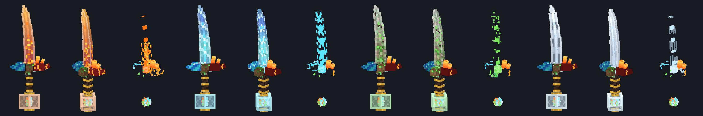

# Меч стихий (Blockbench, Bedrock Entity)



Для каждой стихии слева направо: вид спереди, вид в 3/4, emissive-слой.

## Файлы

| Файл | Назначение |
| --- | --- |
| `elemental_sword.bbmodel` | Проект Blockbench: модель, 8 встроенных текстур, анимация |
| `bedrock/elemental_sword.geo.json` | Геометрия `geometry.elemental_sword` |
| `bedrock/elemental_sword.animation.json` | Анимация `animation.elemental_sword.idle` |
| `textures/elemental_sword_<стихия>.png` | Базовая текстура 64×64 (fire, water, earth, air) |
| `textures/elemental_sword_<стихия>_emissive.png` | Слой свечения для той же развёртки |
| `generate.py` | Скрипт, который собирает всё перечисленное |

Формат — Bedrock Entity: в Java Item нет костей и анимаций, а они нужны для сферы и покачивания клинка.

## Иерархия

```
root
├─ pommel        кристалл и две золотые оправы
│  └─ orb        сфера из трёх повёрнутых кубов (вращается)
├─ handle        рукоять, три кольца, два каменно-кристаллических вкрапления
├─ guard         светящееся ядро, видимое в зазорах между сегментами
│  ├─ guard_fire   основание, шип, два языка пламени
│  ├─ guard_water  основание, завиток, капля, гребень
│  ├─ guard_earth  три слоя породы
│  └─ guard_air    дуга и два парящих завитка
└─ blade         4 сегмента + 4 ребра + 2 куба острия, длина 16
```

Изгиб клинка получен наклоном сегментов на 0°, 3°, 6°, 9°, 12°, 15°. В каждой кости сегмента гарды, в клинке и навершии есть локатор `particles_*` для привязки эмиттеров частиц.

## Анимация

`animation.elemental_sword.idle` — цикл 8 с: сфера делает полный оборот и слегка качается, клинок отклоняется на ±1,5°, воздушный сегмент гарды парит на ±0,25.

## Что нужно сделать в игре

- Прозрачность клинка воды, прорезей воздуха и кристалла работает только с материалом с альфа-смешиванием, например `entity_alphablend`.
- Свечение: наложите emissive-текстуру вторым слоем с материалом `entity_emissive_alpha` либо включите её как слой в Blockbench.
- Смена стихии — подмена пары текстур в render controller; развёртка у всех вариантов одна.
- Частицы (искры, капли, пыль, вихри) в Blockbench не создаются: их делают в Snowstorm и привязывают к локаторам.

## Пересборка

```
uv run --with pillow --with numpy python generate.py
```
